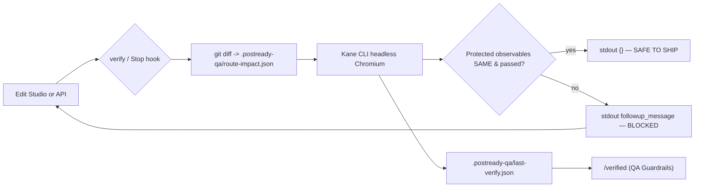

# PostReady

The product is finished — then you still have to click through it, fight modal popups, capture screenshots, record audio, and cut clips just so everyone else can see it. At a hackathon, judges want a live demo, so the last hour goes to recording instead of shipping.

That’s why we built **PostReady**: give a **storefront product link** or a **website / app link**, a plain-English Brief, and your on-screen steps — get a finished **15-second `demo.mp4`** with **SRT captions**, **AI voiceover**, sound design, and animated motion scenes. **[Kane CLI](https://www.testmuai.com/support/docs/kane-cli-introduction/)** is the hands on the live web page (and the agent that verifies PostReady itself end to end). Don’t write brittle selectors or record manual screen captures. Let Kane walk the live site.

Run locally via [Quick start](#quick-start) or jump straight to [Judge PostReady in 60–90 seconds](#judge-postready-in-6090-seconds).

## Table of contents

- [What it is](#what-it-is)
- [Who it is for](#who-it-is-for)
- [Built with](#built-with)
- [Prerequisites](#prerequisites)
- [Quick start](#quick-start)
- [Kane CLI verification](#kane-cli-verification)
  - [Judge PostReady in 60–90 seconds](#judge-postready-in-6090-seconds)
  - [The failure Kane catches](#the-failure-kane-catches)
  - [How this meets the brief](#how-this-meets-the-brief)
  - [Product path — Kane as hands](#product-path--kane-as-hands)
  - [The Kane contract](#the-kane-contract)
  - [How `qa-gate` decides](#how-qa-gate-decides)
  - [Stop hook integration](#stop-hook-integration)
- [How it works](#how-it-works)
  - [What the operator does](#what-the-operator-does)
  - [Job lifecycle](#job-lifecycle)
  - [Store Product vs Website & App capture](#store-product-vs-website--app-capture)
  - [What happens when Kane cannot finish](#what-happens-when-kane-cannot-finish)
- [Kane CLI in this application](#kane-cli-in-this-application)
  - [How every Kane process is spawned](#how-every-kane-process-is-spawned)
  - [Command map](#command-map)
  - [Health, login, balance, and window](#health-login-balance-and-window)
  - [Preflight (`kane-cli run`)](#preflight-kane-cli-run)
  - [Live Store & Website Capture (`kaneInspectProduct` / `kaneCaptureWebsite`)](#live-store--website-capture)
  - [TestMD Walkthrough Path (`kaneUnderstand` + `kaneTestmdRun`)](#testmd-walkthrough-path)
  - [NDJSON telemetry, action log, and run console](#ndjson-telemetry-action-log-and-run-console)
  - [Result codes and aborts](#result-codes-and-aborts)
  - [Studio TestMD suite](#studio-testmd-suite)
- [Studio UI](#studio-ui)
- [HTTP API](#http-api)
- [Workers, storage, and data](#workers-storage-and-data)
- [Configuration](#configuration)
- [Optional Docker](#optional-docker)
- [Repository layout](#repository-layout)

---

## What it is

PostReady is a **browser-agent video creation studio**. You pick a mode (**Store Product** or **Website & App**), paste a URL, enter a short Brief and ordered capture steps, choose a direction style (**Director AI**, **3D Showcase**, **Story Reel**, **Classic Cards**), visual theme, and video size (`9:16`, `4:5`, `1:1`, or `16:9`).

PostReady drives **Kane CLI** in headless Chromium against the real page and outputs:

- an animated **MP4** (`1080×1920`, `1080×1350`, `1080×1080`, or native `1920×1080` widescreen) synced with spoken neural voiceover & procedural stereo SFX/BGM
- **SRT captions**, **timeline.json**, and standalone **HTML composition (`index.html`)**
- a **Kane CLI action log** and raw **NDJSON telemetry** trace of every navigate / click / scroll / extract / assert event

Kane is not an afterthought check bolted onto static screenshots. Kane **is** the browser actuator that dismisses popups, selects options, navigates views, and extracts live page proof so Gemini Vision and the render engine work directly from authentic live captures.

## Who it is for

- **Website owners, founders, and PMs** — your SaaS app or landing page is live, and you need a crisp `16:9` product launch trailer with real UI flows instead of re-recording Loom takes after every UI change.
- **E-commerce & DTC brands** — turn any storefront link into a punchy `9:16` vertical short with lifted background cutouts, verified price/facts, and voiceover.
- **Hackathon builders** — ship code up to the deadline and let Kane explore the live app and render the demo.
- **Teams wanting end-to-end UI guardrails** — [`@postready/qa-gate`](packages/qa-gate) enforces diff-aware Chrome TestMD verification on PostReady itself before edits ship.

## Built with

| Service / tool | Purpose in PostReady |
| --- | --- |
| **Kane CLI** (`@testmuai/kane-cli`) | Autonomous browser runtime (`whoami`, `login`, `balance`, `config`, `run`, `generate`, `testmd run`), live NDJSON telemetry, result codes, and evidence screenshots. |
| **`qa-gate`** (`packages/qa-gate`) | Git-diff → Kane TestMD replay → semantic observable baseline comparison + stop hook. |
| **Temporal** | Durable `KaneDemoWorkflow` across `control`, `kane-chrome`, and `media` queues with slot leases, retries, heartbeats, and cancellation. |
| **PostgreSQL** | Persistent jobs table, streaming event logs (`SSE`), and Chrome slot leases. |
| **Supabase Storage** | Private object bucket for signed `demo.mp4`, `captions.srt`, `timeline.json`, `index.html`, and Kane logs. |
| **Google Gemini Vision** | Multimodal Creative Director inspecting live `448×448` captures + Brief to write storyboards (`composeDirected` / `composeWebsiteLaunch`) and timed voiceover. |
| **edge-tts / LMNT / ElevenLabs** | Neural speech synthesis speed-matched cleanly to beat/scene durations (`edge-tts` default locally). |
| **HyperFrames + GSAP** | Deterministic composition compilation (`composeDirected`, `composeVideo`, `composeWebsiteLaunch`) rendered to video frames via `hyperframes render`. |
| **FFmpeg & ffprobe** | Transparent PNG PAM flood-fill cutouts (`cutout.ts`), stereo BGM + `sidechaincompress` audio ducking, `atempo` sync, and aspect adaptation. |
| **Playwright Chromium** | Headless Chrome runtime and CDP JPEG frame camera (`chrome-session.ts`) for shared-session walkthroughs. |
| **Fastify** | REST + SSE job API on port **4031**. |
| **Vite + React** | Contact-Sheet Studio UI on port **5173**, proxying `/v1` and `/health` to `:4031`. |
| **Zod** | Request, beat, brief, and storyboard schema validation. |

## Prerequisites

- **Node.js 22+**
- **PostgreSQL** (`DATABASE_URL` configured in `.env`)
- **Temporal CLI** ([`infra/temporal/temporal.exe`](infra/temporal) on Windows or `temporal server start-dev`)
- **Supabase Storage** (`SUPABASE_URL`, `SUPABASE_SERVICE_ROLE_KEY`, `SUPABASE_STORAGE_BUCKET`)
- **Google Chrome** + Playwright Chromium (`npx playwright install chromium`)
- **Kane CLI** (`npm i -g @testmuai/kane-cli && kane-cli login`)
- **`ffmpeg` & `ffprobe`** on `PATH`
- **Python `edge-tts`** (`pip install edge-tts`) for local neural voiceover
- **`GEMINI_API_KEY`** in `.env` (falls back to deterministic copy cleanly when omitted)

Copy [`env.example`](env.example) to `.env`. Do not commit `.env`.

## Quick start

```bash
npm install
npm run migrate

# Terminal 1: Temporal (UI at http://localhost:8233)
./infra/temporal/temporal.exe server start-dev --port 7233

# Terminals 2–4: API Server (:4031), Temporal Runner, Web App (:5173)
npm run dev:server
npm run dev:runner
npm run dev:web
```

Open:

- **Studio UI (Short Studio):** `http://localhost:5173`
- **Render Library:** `http://localhost:5173/jobs`
- **QA Guardrails:** `http://localhost:5173/verified`
- **Product Deck:** `http://localhost:5173/pitch`
- **API Health:** `http://127.0.0.1:4031/health`

Run Studio QA checks (with API `:4031` and Studio `:5173` running):

```bash
npm run test:qa-gate # 16 offline unit tests (NDJSON parser, comparator, flow-map)
npm run verify:status      # git diff impact check (no Chrome)
npm run verify:baseline    # record trusted observables in .postready-qa/baseline.json
npm run verify -- --all    # replay all 5 TestMD checks in real Chromium
```

---

## Kane CLI verification

PostReady integrates **Kane CLI** across three complementary layers — all using `--agent`, never hardcoded selector scripts:

| Layer | Kane’s job | Where |
| --- | --- | --- |
| **Product (Live Capture)** | Hands on any user-provided URL. `KaneDemoWorkflow` runs preflight + live Store Shopper (`kaneInspectProduct`), Website & App explorer (`kaneCaptureWebsite`), or TestMD walkthrough (`kaneTestmdRun`). | [`packages/orchestrator/src/workflow.ts`](packages/orchestrator/src/workflow.ts), [`packages/pipeline/src/browser-agent.ts`](packages/pipeline/src/browser-agent.ts) |
| **Studio QA Suite** | Exercises PostReady UI and API in real Chromium (`wizard`, `validation`, `landing`, `gallery`, `api_health`) without triggering billing/long production renders during CI checks. | [`qa-specs/`](qa-specs/), `npm run test:qa-specs` |
| **Regression Gate (`qa-gate`)** | Maps working-tree diffs via `.postready-qa/route-impact.json` to impacted TestMD files, replays them in Chromium, compares named observables against `.postready-qa/baseline.json`, and blocks agent completion if protected checks shift. | [`packages/qa-gate`](packages/qa-gate), [`.postready/hooks.json`](.postready/hooks.json) |

### Judge PostReady in 60–90 seconds

1. **Check the live stack & offline unit tests (~5s):**

```bash
curl http://127.0.0.1:4031/health
npm run test:qa-gate        # 16/16 unit tests (0 Chrome / 0 credits)
npm run verify:status             # inspect diff blast radius
```

2. **Walk the 5 routes at `http://localhost:5173` (~30s):**
   - **Short Studio (`/`):** Switch between **Store Product** (`https://drinkolipop.com/products/vintage-cola`, `9:16`) and **Website & App** (`https://cal.com`, `16:9`), inspect **Brief** + **Style** (`Director AI`, `3D Showcase`, `Story Reel`, `Classic Cards`) + **Launch** attestation.
   - **Render Library (`/jobs`):** Filter by `All` / `Completed` / `Running` / `Failed` / `Aborted` or search completed renders in filmstrip cards.
   - **Production Inspector (`/jobs/:id`):** Click any completed render (both a `9:16` **Store Product** short and a `16:9` **Website & App** launch film) to inspect the 7 pipeline stages, download MP4/SRT/HTML/Kane log, and expand the dark **Kane CLI · Live run** console.
   - **QA Guardrails (`/verified`):** Review `SAFE TO SHIP` and `BLOCKED` verification report cards.
   - **Product Deck (`/pitch`):** Step through the 9-slide deck with `←` / `→`.

3. **Replay the live browser QA gate (~45–90s per flow or `--all`):**

```bash
npm run verify -- --all           # replays qa-specs/*_test.md in Chromium and compares against baseline.json
```

Four numbers, all reproducible directly from this repo:

| Metric | Meaning |
| --- | --- |
| **5** | Protected Studio & API TestMD specs (`wizard`, `validation`, `landing`, `gallery`, `api_health`) |
| **16** | Offline unit tests covering NDJSON parsing, semantic comparison, and diff mapping (`npm run test:qa-gate`) |
| **2** | End-to-end HyperFrames render pipelines (**Store Product** portrait + **Website & App** native `1920×1080` widescreen) |
| **`followup_message`** | Structured stop-hook block response forcing agent repair until Chrome checks pass (`loop_limit: 3`) |

### The failure Kane catches

Using `npm run verify:plant` / `npm run verify:restore`, turning the wizard's `Continue` button into `type="submit"` without advancing the step rail still prevents job submission cleanly — yet users can never reach Brief, Style, or Launch. Because Kane replays `qa-specs/creator_wizard_test.md` as a real user, Kane stops at `Product to Brief`, reports `launch_heading: MISSING`, fails the gate (`BLOCKED`, recorded in [`apps/web/public/qa/blocked-run.json`](apps/web/public/qa/blocked-run.json)), and only stamps **`SAFE TO SHIP`** after `ShortStudio.tsx` restores working navigation and matches `.postready-qa/baseline.json`.

### How this meets the brief

- **Ships.** End-to-end Temporal execution from one URL + Brief to real MP4s, captions, HTML compositions, and signed cloud links in Render Library.
- **Verified.** Kane inspects live third-party stores/websites (aborting cleanly on CAPTCHA, Cloudflare, MFA, or paywalls) and checks PostReady itself via `qa-specs/*_test.md`.
- **Closed loop.** Working-tree changes map cleanly through [`route-impact.json`](.postready-qa/route-impact.json) -> headless Chrome replay -> baseline diff -> `.postready-qa/last-verify.json` -> `/verified` + stop-hook enforcement.
- **Craft.** Tactile Contact Sheet & Lab Notebook UI paired with GSAP choreography, procedural stereo audio ducking, and crisp `1920×1080` browser framing.

### Product path — Kane as hands

Inside [`KaneDemoWorkflow`](packages/orchestrator/src/workflow.ts), **`product_short`** and **`website_short`** share the durable backbone:

`toolingHealth` → `acquireChromeSlot` → `kanePreflight` → (`kaneInspectProduct` OR `kaneCaptureWebsite`) → `releaseChromeSlot` → `directProductShort` → `renderProductShort`

Every browser step emits telemetry events (`kane_cmd`, `kane_step`, `ndjson`, `phase`) persisted in Postgres and streamed live to `/jobs/:id`.

### The Kane contract

Committed specs under [`qa-specs/`](qa-specs/) run via `kane-cli --local testmd run <spec> --agent --headless` (`timeout` 90–240s). Specs store named observables (`default_product`, `launch_heading`, `wizard_url`, `url_required_message`, `gallery_heading`, `health_ok`) without ever clicking final submission buttons (`Create product short`) so QA suites stay side-effect-free.

| File | Covers | Protected / observed |
| --- | --- | --- |
| [`qa-specs/landing_page_test.md`](qa-specs/landing_page_test.md) | Hero branding, SVG logos, mode tabs, defaults | `default_product` |
| [`qa-specs/creator_wizard_test.md`](qa-specs/creator_wizard_test.md) | Product → Brief → Style → Launch → Back | `launch_heading`, `wizard_url` |
| [`qa-specs/url_validation_test.md`](qa-specs/url_validation_test.md) | Empty URL stays on step 01 with inline error | `url_required_message` |
| [`qa-specs/render_library_test.md`](qa-specs/render_library_test.md) | Render Library metrics, tiles & optional job open | `gallery_heading` |
| [`qa-specs/health_check_test.md`](qa-specs/health_check_test.md) | `GET /health` database/Temporal/slot check | `health_ok` (observed) |
| [`qa-specs/smoke_flow_test.md`](qa-specs/smoke_flow_test.md) | Fast smoke check (`npm run test:qa-specs`) | — |

### How `qa-gate` decides



1. **Diff & Impact** — maps modified paths using [`.postready-qa/route-impact.json`](.postready-qa/route-impact.json). Edits under `packages/pipeline/**`, `packages/orchestrator/**`, `packages/core/**`, and `docs/**` are ignored by the UI gate so pipeline iteration never triggers unnecessary browser re-runs.
2. **Preflight** — verifies Studio (`:5173`), API (`:4031/health`), and `.postready-qa/baseline.json`.
3. **Run & Parse** — executes impacted `_test.md` suites in Chrome and reads `test_md_summary` + `final_state`/`variables` from NDJSON (`Exit 2`/`3` and empty streams classify as `error`, never silent passes).
4. **Compare** — matches protected keys (`SAME` / `UNEXPECTED_CHANGE` / `MISSING`) and saves `.postready-qa/last-verify.json` (`GET /v1/verified`).

### Stop hook integration

[`.postready/hooks.json`](.postready/hooks.json) invokes [`.postready/hooks/qa-gate-stop.sh`](.postready/hooks/qa-gate-stop.sh) (`tsx packages/qa-gate/src/bin.ts hook`) with `loop_limit: 3` and `failClosed: false`. Exit code stays `0`; blocking happens cleanly through `{ "followup_message": "..." }` when protected behavior shifts.

---

## How it works

### What the operator does

In [`apps/web/src/views/ShortStudio.tsx`](apps/web/src/views/ShortStudio.tsx):

1. **01 Product / Website** — Toggle **Store Product** or **Website & App**, enter URL & Brand/Product name.
2. **02 Brief** — Enter what the video is about, target audience, main result to highlight, and ordered **Steps for Kane to capture** (`+ Add step`).
3. **03 Style** — Pick **Ad Style** (`Director AI`, `3D Showcase`, `Story Reel`, `Classic Cards`), **Visual Theme** (`Auto`, `Pop`, `Noir`, `Editorial`, `Neon`), **Video Size** (`9:16`, `4:5`, `1:1`, `16:9`), AI voiceover + music toggle, and optional site credentials (redacted before persistence).
4. **04 Launch** — Attest recording rights and dispatch `POST /v1/jobs`.

### Job lifecycle

1. **`health`** — [`toolingHealth`](packages/pipeline/src/health.ts) verifies Kane auth + `acquireChromeSlot`.
2. **`preflight`** — [`kanePreflight`](packages/pipeline/src/browser-agent.ts) screens target URL for bots/CAPTCHAs/paywalls/login walls.
3. **`understand`** — [`kaneInspectProduct`](packages/pipeline/src/browser-agent.ts) (for storefronts) or [`kaneCaptureWebsite`](packages/pipeline/src/browser-agent.ts) (for websites/apps) runs live browser steps, harvests screenshots (`harvestKaneVisuals` + keyframe selection), enriches metadata, generates `448×448` thumbnails, and releases the Chrome slot.
4. **`plan`** — [`directProductShort`](packages/pipeline/src/vision-director.ts) sends `448px` captures + grounded facts + Brief to Gemini Vision to output either a `PostReadyStoryboard` (`director`) or `PostReadyBrief` (`depth`/`reel`/`classic`) + timed voiceover lines.
5. **`tts`** — Synthesizes narration (`edge-tts` / LMNT / ElevenLabs), time-fits speech via `atempo`, synthesizes deterministic stereo BGM + cut SFX (`soundtrack`), and sidechain-ducks music cleanly beneath voice.
6. **`render` & `upload`** — [`renderProductShort`](packages/pipeline/src/render-media.ts) renders portrait compositions (`composeDirected` / `composeVideo`) OR native `1920×1080` widescreen browser showcases (`composeWebsiteLaunch` for `website_short` `16:9`), adapts final aspect ratio cleanly, generates `captions.srt` & `timeline.json`, and uploads artifacts to Supabase Storage.

### Store Product vs Website & App capture

- **Store Product (`product_short`)** merges Shopify `.json`/HTML metadata (`product-scraper.ts`) with live Kane DOM extraction, downloads product gallery images, lifts transparent PNG cutouts (`alpha-cutout.ts`), and stages kinetic `9:16` product scenes.
- **Website & App (`website_short`)** relies directly on Kane CLI's live sequential desktop screenshots across the user's requested actions (`pickKeyFrames` up to 4 distinct screens), skipping retail background cutouts and framing every live capture cleanly inside native `1920×1080` browser windows (`composeWebsiteLaunch` + `LAUNCH_CUES`).

### What happens when Kane cannot finish

- CAPTCHA (`610`), paywall (`620`), access denied (`640`), error pages (`650`), missing credentials on login walls (`660`), auth issues (`550`), or empty credits (`560`) terminate immediately via [`abortFromRunEnd`](packages/pipeline/src/health.ts) with descriptive messages surfaced directly in Production Inspector.
- `try/finally` inside `KaneDemoWorkflow` always guarantees Chrome slot release on completion, failure, or cancellation.

---

## Kane CLI in this application

### How every Kane process is spawned

[`spawnKane`](packages/pipeline/src/cli-runner.ts) spawns `kane-cli` with `shell: false`, injecting `--local` unless `KANE_WS_ENDPOINT` is configured, parsing stdout NDJSON line-by-line into Temporal heartbeats and Postgres events (`kane_step`), and enforcing clean timeouts.

### Command map

| Kane CLI invocation | Purpose | Source |
| --- | --- | --- |
| `whoami` / `login` / `balance` / `config show` / `config set-window 1440x900` | Pre-run health, auth & viewport | [`health.ts`](packages/pipeline/src/health.ts) |
| `run <objective> --agent --mode action --url ...` | `kanePreflight`, `kaneInspectProduct`, `kaneCaptureWebsite`, `kaneUnderstand` | [`browser-agent.ts`](packages/pipeline/src/browser-agent.ts) |
| `generate <prompt> --agent --url ...` | TestMD author generation helper | [`browser-agent.ts`](packages/pipeline/src/browser-agent.ts) |
| `testmd run <file> --agent ...` | Walkthrough authoring (`kaneTestmdRun`) & Studio QA (`qa-specs/*_test.md`) | [`browser-agent.ts`](packages/pipeline/src/browser-agent.ts), [`packages/qa-gate`](packages/qa-gate) |

### Health, login, balance, and window

[`toolingHealth`](packages/pipeline/src/health.ts) confirms CLI auth (`whoami`, falling back to `KANE_USERNAME` / `KANE_ACCESS_KEY` if set), fetches credit state (`balance`), and sets `1440x900` window size before acquiring Chrome slot locks.

### Preflight (`kane-cli run`)

[`kanePreflight`](packages/pipeline/src/browser-agent.ts) opens the target URL once with `--timeout 60 --max-steps 15`, dismisses banners, inspects blocker states (`has_captcha`, `has_bot_challenge`, `has_login_wall`, `has_mfa`, `has_paywall`), and aborts early if human intervention is required.

### Live Store & Website Capture

[`kaneInspectProduct`](packages/pipeline/src/browser-agent.ts) and [`kaneCaptureWebsite`](packages/pipeline/src/browser-agent.ts) drive `--agent --mode action --timeout 180 --max-steps 22`, executing user-specified ordered capture instructions before calling `harvestKaneVisuals(..., true)` to pull step stills directly out of Kane's evidence directory.

### TestMD Walkthrough Path

For legacy `walkthrough` jobs, `kaneUnderstand` -> `planDemoBeats` -> `synthesizeBeats` -> `compileTestMd` -> `kaneTestmdRun` (with Playwright CDP camera [`runWithRecordedChrome`](packages/pipeline/src/cdp-recorder.ts)) -> `assembleDemo` remains intact inside [`KaneDemoWorkflow`](packages/orchestrator/src/workflow.ts).

### NDJSON telemetry, action log, and run console

[`kaneEventHandler`](packages/pipeline/src/telemetry.ts) writes human-readable `kane-actions.log` alongside raw `kane-actions.jsonl` and emits `kane_step` Postgres events so [`LiveTelemetry`](apps/web/src/widgets/LiveTelemetry.tsx) updates live during active runs.

### Result codes and aborts

`RESULT_ABORT_CODES` and `ABORT_MESSAGES` in [`packages/core/src/contracts.ts`](packages/core/src/contracts.ts) normalize Kane native `550`/`560`/`610`/`620`/`640`/`650`/`660` status codes into actionable UI errors.

### Studio TestMD suite

Committed Chromium checks in [`qa-specs/`](qa-specs/) (`landing_page_test.md`, `creator_wizard_test.md`, `url_validation_test.md`, `render_library_test.md`, `health_check_test.md`, `smoke_flow_test.md`, plus `shared/open_app.md` and `shared/close_banners.md`).

```bash
npm run test:qa-specs
npm run test:qa-gate
npm run verify:baseline
npm run verify -- --all
```

---

## Studio UI

| Route / Surface | File | Responsibility |
| --- | --- | --- |
| Header & Shell | [`apps/web/src/Router.tsx`](apps/web/src/Router.tsx) | `Short Studio`, `Render Library`, `QA Guardrails`, `Product Deck` nav + live `/health` status |
| **Short Studio** (`/`) | [`apps/web/src/views/ShortStudio.tsx`](apps/web/src/views/ShortStudio.tsx) | **Store Product** & **Website & App** 4-step creator wizard (`Product/Website → Brief → Style → Launch`) |
| **Render Library** (`/jobs`) | [`apps/web/src/views/RenderLibrary.tsx`](apps/web/src/views/RenderLibrary.tsx) | Filmstrip card grid with status filter tabs, search input, active queue badge & MP4 previews |
| **Production Inspector** (`/jobs/:id`) | [`apps/web/src/views/ProductionInspector.tsx`](apps/web/src/views/ProductionInspector.tsx) | 2-column pipeline progress, Metadata & Brief cards, video preview player & `Kane CLI · Live run` console |
| **QA Guardrails** (`/verified`) | [`apps/web/src/views/QaGuardrails.tsx`](apps/web/src/views/QaGuardrails.tsx) | `SAFE TO SHIP` / `BLOCKED` TestMD verdict banners, flow deltas & 4-step verification loop |
| **Product Deck** (`/pitch`) | [`apps/web/src/views/ProductDeck.tsx`](apps/web/src/views/ProductDeck.tsx) | Interactive 9-slide keyboard-navigable showcase deck |
| Pipeline & Artifact Player | [`apps/web/src/widgets/StageChecklist.tsx`](apps/web/src/widgets/StageChecklist.tsx) | Step checklist for Store, Website & Walkthrough jobs + `ArtifactCard` |
| Run Console | [`apps/web/src/widgets/LiveTelemetry.tsx`](apps/web/src/widgets/LiveTelemetry.tsx) | Live NDJSON / Capture map / Plan / Voice / Heal log rows |
| Proxy | [`apps/web/vite.config.ts`](apps/web/vite.config.ts) | Proxies `/v1` and `/health` to API `:4031` |

---

## HTTP API

Implemented in [`apps/server/src/index.ts`](apps/server/src/index.ts):

| Method | Path | Role |
| --- | --- | --- |
| `GET` | `/health` | Ping Postgres, inspect Temporal endpoint, report free Chrome slots |
| `GET` | `/v1/verified` | Return `.postready-qa/last-verify.json`, snapshots, and `.postready-qa/baseline.json` |
| `POST` | `/v1/jobs` | Validate payload (`createJobBodySchema`), redact credentials, start `KaneDemoWorkflow` |
| `GET` | `/v1/jobs` | List recent render jobs |
| `GET` | `/v1/jobs/:id` | Fetch job status + signed Supabase artifact links |
| `GET` | `/v1/jobs/:id/events` | Job event history JSON or SSE stream (`Accept: text/event-stream`) |
| `GET` | `/v1/jobs/:id/artifacts/:kind` | `302` redirect to signed artifact (`video`, `captions`, `composition`, `timeline`, `kane-log`, `kane-jsonl`) |
| `POST` | `/v1/jobs/:id/confirm-script` | Deliver `confirmScript` signal to awaiting walkthrough workflows |
| `POST` | `/v1/jobs/:id/cancel` | Cancel Temporal workflow execution |

---

## Workers, storage, and data

- **Worker:** [`apps/runner/src/worker.ts`](apps/runner/src/worker.ts) polls `control`, `kane-chrome`, and `media` task queues.
- **Workflow:** [`packages/orchestrator/src/workflow.ts`](packages/orchestrator/src/workflow.ts) runs `KaneDemoWorkflow`.
- **Database & Schema:** [`packages/core/src/postgres.ts`](packages/core/src/postgres.ts) and [`infra/schema.sql`](infra/schema.sql) manage `jobs`, `job_events`, and Chrome slots (`npm run migrate`).
- **Storage:** [`packages/core/src/bucket.ts`](packages/core/src/bucket.ts) stores artifacts under `postready/<mode>/<jobId>/...` with signed download URLs.

---

## Configuration

See [`env.example`](env.example) for all environment keys:

| Variable | Purpose |
| --- | --- |
| `DATABASE_URL` | PostgreSQL connection URI |
| `TEMPORAL_ADDRESS` / `TEMPORAL_NAMESPACE` | Temporal server endpoint & namespace |
| `API_PORT` / `PUBLIC_API_BASE_URL` | Fastify API bind (`4031`) and public base URL |
| `SUPABASE_URL` / `SUPABASE_SERVICE_ROLE_KEY` / `SUPABASE_STORAGE_BUCKET` | Supabase object storage credentials |
| `GEMINI_API_KEY` / `GEMINI_TEXT_MODEL` | Gemini Vision creative direction |
| `EDGE_TTS_VOICE` / `LMNT_API_KEY` / `ELEVENLABS_API_KEY` | Voice synthesis providers |
| `KANE_USERNAME` / `KANE_ACCESS_KEY` / `KANE_PROJECT_ID` | Kane CLI worker login credentials |
| `KANE_WS_ENDPOINT` / `KANE_HEADLESS` / `KANE_HEADED` | Local vs cloud Chrome browser control |
| `WORKER_IDENTITY` | Unique Chrome slot lease owner ID |

---

## Optional Docker

[`infra/docker-compose.yml`](infra/docker-compose.yml) and root Dockerfiles (`Dockerfile.server`, `Dockerfile.runner`, `Dockerfile.web`, `Dockerfile.temporal`) support containerized deployment alongside Nginx SPA routing. For local Windows development, running Temporal + API + Worker + Studio directly requires zero Docker containers if PostgreSQL & Supabase are remote.

---

## Repository layout

```text
apps/server              Fastify REST + SSE API (:4031, /v1/jobs, /v1/verified)
apps/runner              Temporal worker polling control, kane-chrome & media
apps/web                 Vite + React UI (Short Studio, Render Library, QA Guardrails, Product Deck)
packages/core            Zod schemas, TypeScript contracts, Postgres & Supabase Storage helpers
packages/pipeline        Kane CLI runners, Gemini Vision director, compositing engine, audio & FFmpeg
packages/orchestrator    Temporal KaneDemoWorkflow (product_short, website_short, walkthrough)
packages/qa-gate         NDJSON parser, observable comparator, route-impact gate & stop hook
qa-specs/                Committed Chromium TestMD suites & shared helpers
.postready-qa/           Route-impact map, gate config & trusted baseline observables
.postready/              Stop hook wiring qa-gate
docs/qa-proof/           Saved baseline & verification proof artifacts
infra/                   Temporal CLI binary, SQL schema, nginx config & Docker compose
env.example              Environment template
```
