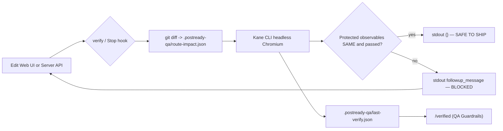

# PostReady

The product is finished — then you still have to click through it, fight modal popups, capture screenshots, record voiceover, and cut clips just so everyone else can see it. At a hackathon, judges want a demo, so the last hour goes to recording instead of shipping. Thousands of builders and store owners face the same gap between *built* and *shown*.

That’s why we built **PostReady**: give a **storefront product link** or a **website / app link**, a plain-English Brief, and your on-screen capture steps — get a finished **15-second `demo.mp4`** with **SRT captions**, **AI voiceover**, sound design, and animated motion scenes. **[Kane CLI](https://www.testmuai.com/support/docs/kane-cli-introduction/)** is the hands on the live web page (and the agent that verifies PostReady itself end to end). Don’t write brittle selectors or record manual walkthroughs. Let Kane walk the live site.

Run locally via [Quick start](#quick-start), jump straight to [Judge PostReady in 60–90 seconds](#judge-postready-in-6090-seconds), or watch the [YouTube Demo Video](https://youtu.be/wCxfWUsdLIE) and read the [dev.to Launch Post](https://dev.to/toufiq_farhan/postready-turn-any-product-or-website-link-into-a-15s-launch-video-using-real-chromium-kane-cli-5a89).

## Table of contents

- [What it is](#what-it-is)
- [Who it is for](#who-it-is-for)
- [Lane 3](#lane-3)
- [Important links](#important-links)
- [Built with](#built-with)
- [Prerequisites](#prerequisites)
- [Quick start](#quick-start)
- [Kane CLI verification](#kane-cli-verification)
  - [Judge PostReady in 60–90 seconds](#judge-postready-in-6090-seconds)
  - [The failure Kane catches](#the-failure-kane-catches)
  - [How the demo regression drill works](#how-the-demo-regression-drill-works)
  - [How this meets the brief](#how-this-meets-the-brief)
  - [Product path — Kane as hands](#product-path--kane-as-hands)
  - [The Kane contract](#the-kane-contract)
  - [How `qa-gate` decides](#how-qa-gate-decides)
  - [Stop hook integration](#stop-hook-integration)
  - [Caveats and limitations](#caveats-and-limitations)
- [How it works](#how-it-works)
  - [What the operator does](#what-the-operator-does)
  - [Job lifecycle](#job-lifecycle)
  - [Store Product vs Website & App capture](#store-product-vs-website--app-capture)
  - [Why one Chrome session](#why-one-chrome-session)
  - [How picture meets voice](#how-picture-meets-voice)
  - [What happens when Kane cannot finish](#what-happens-when-kane-cannot-finish)
- [Kane CLI in this application](#kane-cli-in-this-application)
  - [How every Kane process is spawned](#how-every-kane-process-is-spawned)
  - [Command map](#command-map)
  - [Health, login, balance, and window](#health-login-balance-and-window)
  - [Preflight (`kane-cli run`)](#preflight-kane-cli-run)
  - [Understand & live capture (`kane-cli run`)](#understand--live-capture-kane-cli-run)
  - [Generate (`kane-cli generate`)](#generate-kane-cli-generate)
  - [Compile TestMD](#compile-testmd)
  - [Author (`kane-cli testmd run`)](#author-kane-cli-testmd-run)
  - [CDP camera](#cdp-camera)
  - [Beat windows, harvest, and gates](#beat-windows-harvest-and-gates)
  - [NDJSON telemetry, action log, and run console](#ndjson-telemetry-action-log-and-run-console)
  - [Result codes and aborts](#result-codes-and-aborts)
  - [Evidence rewrite](#evidence-rewrite)
  - [Per-beat `run` helper](#per-beat-run-helper)
  - [Studio TestMD suite](#studio-testmd-suite)
- [Studio UI](#studio-ui)
- [HTTP API](#http-api)
- [Workers, storage, and data](#workers-storage-and-data)
- [Configuration](#configuration)
- [Verified live runs](#verified-live-runs)
- [Optional Docker and deployment](#optional-docker-and-deployment)
- [Repository layout](#repository-layout)

---

## What it is

PostReady is a **browser-agent video creation studio**. You pick a format (**Store Product** or **Website & App**), paste a URL, enter a goal/audience/result Brief and ordered capture steps, choose a direction style (**Director AI**, **3D Showcase**, **Story Reel**, **Classic Cards**), visual theme (`Auto`, `Pop`, `Noir`, `Editorial`, `Neon`), and video size (`9:16`, `4:5`, `1:1`, or `16:9`).

PostReady drives **Kane CLI** against the real web page and outputs:

- an animated **MP4** (`1080×1920`, `1080×1350`, `1080×1080`, or native `1920×1080` widescreen) timed to spoken neural voiceover & procedural stereo SFX/BGM
- **SRT captions**, **`timeline.json`**, and standalone animated **HTML composition (`index.html`)**
- a **Kane CLI action log (`kane-actions.log`)** and raw **NDJSON (`kane-actions.jsonl`)** of every navigate / click / scroll / extract / assert step

Kane is not an afterthought check bolted onto static screenshots. Kane **is** the hands on the page. The rest of the stack (Temporal workflow, Gemini Vision director, `edge-tts` / LMNT voice synthesis, HyperFrames + GSAP motion engine, FFmpeg mux & cutouts) turns that real browser session into a polished launch artifact.

## Who it is for

- **Website owners, founders, and PMs** — your SaaS app or landing page is done, yet you still need a `16:9` product trailer showing live views without re-recording Loom takes after every ship.
- **E-commerce & DTC brands** — turn any storefront product URL (e.g. OLIPOP, Death Wish Coffee, Shopify products) into a `9:16` vertical ad with background-lifted cutouts, scraped pricing/badges, and voiceover.
- **Hackathon builders** — judges want a working product video while your last hours go to shipping features. Generate a narrated launch film directly from your live app.
- **Sales engineers & marketers** — get repeatable product & workflow showcase films from a short Brief rather than manual timeline editing.
- **Teams wanting agentic UI guardrails** — [`@postready/qa-gate`](packages/qa-gate) maps code diffs onto committed TestMD specs and verifies PostReady itself in headless Chromium before edits ship.

Default creator tabs are prefilled for `https://drinkolipop.com/products/vintage-cola` (**Store Product**, `9:16`) and `https://cal.com` (**Website & App**, `16:9`), and any live public storefront or web app URL works directly.

## Lane 3

PostReady is built for **Lane 3 — Agents with hands on the real web**: Kane CLI operating in live Chromium without site-specific APIs or hardcoded CSS selectors:

- Operators supply English actions (`Dismiss any cookie banner`, `Scroll down to show key features`, `Open Pricing`). Kane CLI runs them via `--agent`, TestMD, `--local-context`, and stored `final_state` variables.
- For both **Store Product** (`kaneInspectProduct`) and **Website & App** (`kaneCaptureWebsite`) runs — as well as Playwright CDP-recorded walkthroughs (`kaneTestmdRun` + `runWithRecordedChrome`) — Kane drives the real `http(s)` session while the pipeline harvests live screenshots and telemetry.
- Kane’s stdout NDJSON IS the live product telemetry: **Production Inspector** (`/jobs/:id`) streams real `kane_cmd`, `kane_step`, `phase`, `heal`, and `ndjson` rows into Postgres and SSE, never mocked logs.
- A committed TestMD suite also tests **PostReady itself**: [`qa-gate`](packages/qa-gate) maps working-tree changes via [`.postready-qa/route-impact.json`](.postready-qa/route-impact.json) to impacted browser flows, replays them in Chrome, and blocks completion via `.postready/hooks.json` if protected observables shift.

## Important links

| Surface / Artifact | Where |
| --- | --- |
| **Short Studio UI** | `http://localhost:5173/` |
| **Render Library** | `http://localhost:5173/jobs` |
| **QA Guardrails (`/verified`)** | `http://localhost:5173/verified` |
| **Product Deck (`/pitch`)** | `http://localhost:5173/pitch` |
| **API Health** | `http://127.0.0.1:4031/health` |
| **Committed TestMD Suite** | [`qa-specs/`](qa-specs/run-all.sh) (`landing_page_test.md`, `creator_wizard_test.md`, `url_validation_test.md`, `render_library_test.md`, `health_check_test.md`, `smoke_flow_test.md`) |
| **QA Proof Reports** | [`docs/qa-proof/`](docs/qa-proof) — [`baseline.json`](docs/qa-proof/baseline.json), [`blocked-run.json`](docs/qa-proof/blocked-run.json), [`verified-run.json`](docs/qa-proof/verified-run.json) |
| **Demo Video (YouTube)** | [youtu.be/wCxfWUsdLIE](https://youtu.be/wCxfWUsdLIE) |
| **Launch Write-up (dev.to)** | [PostReady on dev.to](https://dev.to/toufiq_farhan/postready-turn-any-product-or-website-link-into-a-15s-launch-video-using-real-chromium-kane-cli-5a89) |
| **X (Twitter) Posts** | [Post 1](https://x.com/velnoxvwwd/status/2126006136835084313?a=YSWEMDatNr_PE43Xkdk&s=20) · [Post 2](https://x.com/velnoxvwwd/status/2126008937174671710?a=PcJTt204sz9M4AG9SQo&s=20) |
| **GitHub Repository** | [`toufiqfarhan0/kane-cli-hack`](https://github.com/toufiqfarhan0/kane-cli-hack) |

## Built with

| Service / tool | Purpose in PostReady |
| --- | --- |
| **Kane CLI** (`@testmuai/kane-cli`) | Autonomous browser runtime (`whoami`, `login`, `balance`, `config`, `run`, `generate`, `testmd run`), live NDJSON telemetry, native result codes, and screenshot evidence. |
| **`@postready/qa-gate`** | Diff-to-TestMD router, NDJSON parser, semantic baseline comparator, and stop hook ([`packages/qa-gate`](packages/qa-gate)). |
| **Temporal** | Durable `KaneDemoWorkflow` across `control`, `kane-chrome`, and `media` task queues with Chrome slot leases, heartbeats, retries, and cancellation. |
| **PostgreSQL** | Persistent `jobs`, `job_events` (backing SSE), and `chrome_slots` lease table. |
| **Supabase Storage** | Private object bucket storing signed `demo.mp4`, `captions.srt`, `timeline.json`, `index.html`, `kane-actions.log`, and `kane-actions.jsonl`. |
| **Google Gemini Vision** | Multimodal Creative Director inspecting `448×448` live captures + grounded facts + Brief to write storyboards (`directProductShort`) and beat plans (`planDemoBeats`). |
| **edge-tts / LMNT / ElevenLabs** | Neural voiceover synthesis (`edge-tts` default locally; LMNT/ElevenLabs optional via env) speed-matched cleanly to scene durations. |
| **HyperFrames + GSAP** | Deterministic HTML/GSAP motion compiler rendered to H.264/AAC MP4 (`composeDirected`, `composeVideo`, `composeWebsiteLaunch`). |
| **FFmpeg & ffprobe** | Transparent PNG PAM flood-fill cutouts ([`alpha-cutout.ts`](packages/pipeline/src/engine/alpha-cutout.ts)), procedural stereo BGM + `sidechaincompress` ducking, `atempo` timing, and aspect adaptation. |
| **Playwright Chromium** | Headless Chrome browser and passive CDP JPEG camera ([`cdp-recorder.ts`](packages/pipeline/src/cdp-recorder.ts)) for shared-session walkthrough capture. |
| **Fastify** | REST + SSE job API listening on port **4031**. |
| **Vite + React** | 5-route Contact-Sheet UI listening on port **5173** (`Space Grotesk`, `Inter`, `Space Mono`, `Silkscreen`), proxying `/v1` and `/health` to `:4031`. |
| **Zod** | Job input, Brief, storyboard, and Beat validation ([`validators.ts`](packages/core/src/validators.ts)). |

## Prerequisites

- **Node.js 22+**
- **PostgreSQL** (`DATABASE_URL` configured in `.env`)
- **[Temporal CLI](https://docs.temporal.io/cli)** (`temporal server start-dev --port 7233`)
- **Supabase Storage** (`SUPABASE_URL`, `SUPABASE_SERVICE_ROLE_KEY`, `SUPABASE_STORAGE_BUCKET`)
- **Google Chrome** + Playwright Chromium (`npx playwright install chromium`)
- **Kane CLI** (`npm i -g @testmuai/kane-cli && kane-cli login`)
- **`ffmpeg` & `ffprobe`** on `PATH`
- **Python `edge-tts`** (`pip install edge-tts`) for local neural voiceover
- **Optional:** `GEMINI_API_KEY` (falls back deterministically when omitted), `LMNT_API_KEY`, `ELEVENLABS_API_KEY`

Copy [`env.example`](env.example) to `.env`. Do not commit `.env`. PostReady binds the API on port **4031** to avoid colliding with common port `4021`/`4000` services.

## Quick start

```bash
npm install
npm run migrate

# Terminal 1: Temporal (UI at http://localhost:8233)
temporal server start-dev --port 7233

# Playwright Chromium (used for CDP camera and headless browser runs)
npx playwright install chromium

# Terminals 2–4: API Server (:4031), Temporal Runner (:4098), Web App (:5173)
npm run dev:server
npm run dev:runner
npm run dev:web
```

Open:

- **Short Studio (`/`):** `http://localhost:5173`
- **Render Library (`/jobs`):** `http://localhost:5173/jobs`
- **QA Guardrails (`/verified`):** `http://localhost:5173/verified`
- **Product Deck (`/pitch`):** `http://localhost:5173/pitch`
- **API Health:** `http://127.0.0.1:4031/health`

Walk PostReady with Kane (with Server `:4031` and Web `:5173` running):

```bash
npm run test:qa-gate      # 16 offline unit tests (NDJSON parser, diff engine, impact mapper)
npm run verify:status     # git diff blast-radius preview (0 Chrome, 0 credits)
npm run verify:baseline   # record trusted baseline in .postready-qa/baseline.json
npm run verify -- --all   # replay all 5 TestMD flows in headless Chromium
npm run test:qa-specs     # bash qa-specs/run-all.sh end-to-end suite
```

---

## Kane CLI verification

The hackathon evaluates whether the app works end to end, Kane CLI actually proved/caught something meaningful, and the coding agent ↔ Kane CLI loop closes automatically. PostReady integrates **Kane CLI** across three complementary layers — all using `--agent`, never fragile CSS selector scripts:

| Layer | Kane’s job | Where |
| --- | --- | --- |
| **Product (Lane 3)** | Hands on any user-provided URL. `KaneDemoWorkflow` runs preflight + live Store Shopper (`kaneInspectProduct`), Website & App explorer (`kaneCaptureWebsite`), or TestMD walkthrough (`kaneTestmdRun`). | [`packages/orchestrator/src/workflow.ts`](packages/orchestrator/src/workflow.ts), [`packages/pipeline/src/browser-agent.ts`](packages/pipeline/src/browser-agent.ts) |
| **Studio QA Suite** | Walks PostReady UI & `/health` in real Chromium (`wizard`, `validation`, `landing`, `gallery`, `api_health`) without clicking final job submission buttons during CI checks. | [`qa-specs/`](qa-specs/run-all.sh), `npm run test:qa-specs` |
| **Regression Gate (`qa-gate`)** | Maps working-tree diffs via `.postready-qa/route-impact.json` onto TestMD specs, replays affected flows in Chrome, compares named observables against `.postready-qa/baseline.json`, and blocks stop hooks on regressions. | [`packages/qa-gate`](packages/qa-gate/src/bin.ts), [`.postready/hooks.json`](.postready/hooks.json) |

Pipeline-only edits under `packages/pipeline/**`, `packages/orchestrator/**`, `packages/core/**`, and `docs/**` are ignored by the UI gate in [`route-impact.json`](.postready-qa/route-impact.json) so backend iteration never triggers redundant browser checks.

The closed loop in one sentence: **Edit PostReady UI → `qa-gate` maps changed paths → Kane CLI replays matching TestMD specs in Chromium → missing/shifted observables emit `followup_message` → fix UI → re-verify → `SAFE TO SHIP`.**

### Judge PostReady in 60–90 seconds

1. **Check the live stack & offline unit tests (~5s):**

```bash
curl http://127.0.0.1:4031/health
npm run test:qa-gate              # 16/16 unit tests (0 Chrome / 0 credits)
npm run verify:status             # inspect diff blast radius
```

2. **Walk the 5 routes at `http://localhost:5173` (~30s):**
   - **Short Studio (`/`):** Switch between **Store Product** (`https://drinkolipop.com/products/vintage-cola`, `9:16`) and **Website & App** (`https://cal.com`, `16:9`), step through **Brief** + **Style** (`Director AI`, `3D Showcase`, `Story Reel`, `Classic Cards`) + **Launch** attestation.
   - **Render Library (`/jobs`):** Filter by `All` / `Completed` / `Running` / `Failed` / `Aborted` or search completed renders in filmstrip cards.
   - **Production Inspector (`/jobs/:id`):** Open both a `9:16` **Store Product** short (`OLIPOP` or `Death Wish Coffee`) and a `16:9` **Website & App** film (`Cal.com` or `Resend`) to inspect all 7 stages, preview the MP4, download `MP4`/`SRT`/`HTML`/`kane-actions.log`, and read the live **Kane CLI · Live run** console.
   - **QA Guardrails (`/verified`):** Review `SAFE TO SHIP`, `BLOCKED`, and baseline comparison reports.
   - **Product Deck (`/pitch`):** Step through the 9-slide deck with `←` / `→`.

3. **Replay the live browser QA gate (~45–90s per flow or `--all`):**

```bash
npm run verify -- --all           # replays qa-specs/*_test.md in Chromium and compares against baseline.json
open http://localhost:5173/verified
```

Four reproducible numbers from this repository:

| Metric | Meaning |
| --- | --- |
| **5** | Protected Studio & API TestMD flows (`wizard`, `validation`, `landing`, `gallery`, `api_health`) |
| **16** | Offline unit tests covering NDJSON parsing, semantic comparison, and route-impact mapping (`npm run test:qa-gate`) |
| **4** | Diverse live E2E completed renders verified end to end (**OLIPOP**, **Death Wish Coffee**, **Cal.com**, **Resend**) |
| **`followup_message`** | Structured stop-hook block payload forcing UI repair until Chromium observables match (`loop_limit: 3`) |

### The failure Kane catches

Turning the wizard's `Continue` button into `type="submit"` without `onClick={next}` still leaves form validation passing cleanly (`onSubmit` calls `preventDefault()`, so Kane does not fire an unwanted job submission POST) — yet users can never reach Brief, Style, or Launch. Because Kane replays [`creator_wizard_test.md`](qa-specs/creator_wizard_test.md) like a real browser user, Kane fails to advance, reports `MISSING` observables, and halts completion:

```text
POSTREADY QA BLOCKED COMPLETION

Kane CLI replayed a committed Studio TestMD flow against localhost and it did not match the trusted baseline.
Repair the application code (not the tests in qa-specs/, not .postready-qa/baseline.json) and end your turn again.

Generate wizard no longer passes in a real browser.
  Failed step  Brief to Style
  NDJSON       .postready-qa/runs/verify-wizard.ndjson

The requested change — "Example guard: Continue accidentally submits Stage 0 form instead of advancing Brief" — does not authorize this behavior to move.

Fix the regression in apps/web (typically ShortStudio.tsx Continue must stay type="button" with onClick={next}).
Do not edit qa-specs/*_test.md to make this pass. Do not rewrite the baseline.

Attempt 1 of 3. See /verified and .postready-qa/last-verify.json.
```

Verbatim comparison states from [`blocked-run.json`](docs/qa-proof/blocked-run.json) and full verification run:

```text
BLOCKED — Kane failure

  changed files   2  (ShortStudio.tsx, theme.css → wizard)
  flows replayed  wizard

  Generate wizard  [failed]
      failed step              Brief to Style
      launch_heading           Ready to create OLIPOP Vintage Cola → null   MISSING
      wizard_url               http://localhost:5173/             → null   MISSING
```

```text
VERIFIED — protected Studio behavior is unchanged

  flows replayed  wizard, validation, landing, api_health, gallery

  Generate wizard  [passed]
      launch_heading           Ready to create OLIPOP Vintage Cola → Ready to create OLIPOP Vintage Cola SAME
      wizard_url               http://localhost:5173/       → http://localhost:5173/       SAME
  Site URL validation  [passed]
      url_required_message     Please enter a product link. → Please enter a product link. SAME
  Landing and branding  [passed]
      default_product          OLIPOP Vintage Cola          → OLIPOP Vintage Cola          SAME
  API health  [passed]
      health_ok                true                         → true                         SAME
  Shorts Gallery  [passed]
      gallery_heading          Render Library               → Render Library               SAME
```

- **Blocked treats silence honestly (`MISSING`, not `SAME`):** When Continue never advances, Kane never stores `launch_heading` or `wizard_url`, and the file status fails.
- **Verified confirms restoration:** Once [`ShortStudio.tsx`](apps/web/src/views/ShortStudio.tsx) restores `type="button" onClick={next}`, Kane walks every step cleanly and certifies **`SAFE TO SHIP`**.

### How the demo regression drill works

To let any judge or reviewer reproduce this catch deterministically without touching committed test specs:

- `npm run verify:plant` runs [`break-continue.mjs`](packages/qa-gate/scripts/break-continue.mjs), switching `Continue` in [`ShortStudio.tsx`](apps/web/src/views/ShortStudio.tsx) to `type="submit"` without `onClick={next}`.
- Running `npm run verify` maps [`ShortStudio.tsx`](apps/web/src/views/ShortStudio.tsx) → `wizard`, runs [`creator_wizard_test.md`](qa-specs/creator_wizard_test.md) in real Chrome, fails to reach Brief/Launch, and emits `BLOCKED` (`blocked-run.json` captures this exact shape for `/verified`).
- `npm run verify:restore` runs [`revert-continue.mjs`](packages/qa-gate/scripts/revert-continue.mjs) cleanly (pure file swap, zero destructive git checkout), and re-running `npm run verify` returns **`SAFE TO SHIP`**.

Note: [`ShortStudio.tsx`](apps/web/src/views/ShortStudio.tsx) on `main` ships the clean working button (`type="button"`). Do not commit a planted button state.

### How this meets the brief

Judges score **Ships**, **Verified**, **Closed loop**, and **Craft** equally (tie-breakers: **Verified**, then **Closed loop**):

- **Ships.** End-to-end Temporal workflow from one URL + Brief to finished MP4, captions, HTML composition, and signed cloud links in Render Library across both **Store Product** (`9:16`) and **Website & App** (`16:9`) pipelines.
- **Verified.** Kane CLI exercises third-party sites (aborting cleanly on CAPTCHA, Cloudflare, MFA, login walls, or paywalls) and checks PostReady itself (`5/5` TestMD specs `wizard`, `validation`, `landing`, `api_health`, `gallery` passed in Chromium).
- **Closed loop.** Working-tree edits route through [`route-impact.json`](.postready-qa/route-impact.json) → headless Chrome replay → semantic baseline comparison → `.postready-qa/last-verify.json` → `/verified` + `.postready/hooks.json` `followup_message` enforcement (`loop_limit: 3`). Inside live product runs, `rewriteFailedBeat` also feeds Kane failure diagnostics back into retry instructions.
- **Craft.** Tactile Contact Sheet & Lab Notebook UI (`Space Grotesk`, `Inter`, `Space Mono`, `Silkscreen`) paired with GSAP choreography, procedural stereo audio sidechain ducking, zero console/HTTP errors across all 5 routes, and crisp `1920×1080` widescreen browser framing.

### Product path — Kane as hands

Inside [`KaneDemoWorkflow`](packages/orchestrator/src/workflow.ts), **`product_short`** and **`website_short`** share the durable Temporal backbone:

`toolingHealth` → `acquireChromeSlot` → `kanePreflight` → (`kaneInspectProduct` OR `kaneCaptureWebsite`) → `releaseChromeSlot` → `directProductShort` → `renderProductShort`

Every browser action streams live `kane_cmd`, `kane_step`, `ndjson`, and `phase` events to Postgres and SSE (`GET /v1/jobs/:id/events`) for `/jobs/:id`.

### The Kane contract

Committed specs under [`qa-specs/`](qa-specs/run-all.sh) run via `kane-cli --local testmd run <spec> --agent --headless` (`timeout` 90–300s). Named observables are persisted via `Store ... as '...'` lines without ever clicking final submission buttons (`Create product short`) so QA suites stay side-effect-free:

| File | Covers | Protected / observed |
| --- | --- | --- |
| [`qa-specs/landing_page_test.md`](qa-specs/landing_page_test.md) | Hero branding, SVG logos, mode tabs, defaults | `default_product` |
| [`qa-specs/creator_wizard_test.md`](qa-specs/creator_wizard_test.md) | Product → Brief → Style → Launch → Back | `launch_heading`, `wizard_url` |
| [`qa-specs/url_validation_test.md`](qa-specs/url_validation_test.md) | Empty URL stays on step 01 with inline error | `url_required_message` |
| [`qa-specs/render_library_test.md`](qa-specs/render_library_test.md) | Render Library metrics, tiles & optional job open | `gallery_heading` |
| [`qa-specs/health_check_test.md`](qa-specs/health_check_test.md) | `GET /health` database/Temporal/slot check | `health_ok` (observed) |
| [`qa-specs/smoke_flow_test.md`](qa-specs/smoke_flow_test.md) | Fast smoke check (`npm run test:qa-specs`) | — |

Kane surfaces [`packages/qa-gate`](packages/qa-gate/src/testmd-runner.ts) parses directly:

| Kane surface | How `qa-gate` uses it |
| --- | --- |
| `qa-specs/*_test.md` | Committed human-readable TestMD flows (`*_test.md` required by Kane CLI) |
| `--agent` NDJSON | Machine-readable event stream (`parseNdjson`) |
| `test_md_summary` | Authoritative per-file verdict (`overall_status`), ignoring partial `run_end` steps |
| `final_state` + `context.memory` + `context.variables` | Source of `Store ... as` semantic observations |
| Failed step heading & remark | Surfaced verbatim in block reports (`failedStep`, `reason`) |

### How `qa-gate` decides



| Object | Role |
| --- | --- |
| [`.postready-qa/route-impact.json`](.postready-qa/route-impact.json) | Maps changed file globs to impacted TestMD flows (`[]` = non-UI pipeline file) |
| [`.postready-qa/gate-config.json`](.postready-qa/gate-config.json) | `protect` vs `observe` keys, `fallbackFlow: "landing"`, `maxAttempts: 3`, `perTestTimeoutS: 300`, `hookBudgetS: 1800` |
| [`.postready-qa/baseline.json`](.postready-qa/baseline.json) | Trusted baseline semantic observables from a green Kane run |
| `qa-specs/*_test.md` | Plain-English Chrome tests replayed via Kane CLI |
| `.postready-qa/last-verify.json` | Live verdict (gitignored; surfaced by `/v1/verified`) |
| [`.postready/hooks.json`](.postready/hooks.json) | Stop hook invoking `.postready/hooks/qa-gate-stop.sh` |

Step-by-step gate algorithm (`verify`, `verify --all`, `verify --flow a,b` in [`runner.ts`](packages/qa-gate/src/runner.ts)):

1. **Diff** — inspects unstaged, staged, and untracked changes via `changedFiles`.
2. **Impact** — maps modified paths using [`route-impact.json`](.postready-qa/route-impact.json). Pipeline packages (`core`, `pipeline`, `orchestrator`, `qa-gate`, `docs`) are ignored; unmapped UI files fall back to `landing`.
3. **Preflight** — confirms Web `:5173`, Server `:4031/health`, and `.postready-qa/baseline.json`.
4. **Run** — replays impacted `*_test.md` files highest-risk first (`kane-cli --local testmd run ... --agent --headless`), retrying non-infra failures once for flake resistance.
5. **Parse** — derives verdict from `test_md_summary` (`exit 2`/`3` or empty stream → infra `error`, never silent pass).
6. **Compare** — marks protected keys `SAME`, `UNEXPECTED_CHANGE`, or `MISSING` (blank values map to `MISSING`). `observe` keys (`health_ok`) are informational.
7. **Decide** — failed flow or `UNEXPECTED_CHANGE` → `blocked` (`exit 1` in CLI, `{ "followup_message": "..." }` in hook); infra failure → `error` (`exit 2`); clean match → `passed` (`exit 0`).

```bash
npm run verify:status                          # dry blast-radius check (0 Chrome)
npm run verify:baseline [-- --flow wizard]     # record trusted observables
npm run verify [-- --all | --flow a,b]         # exit 0 passed, 1 blocked, 2 error
npm run cli -w @postready/qa-gate -- hook      # stop-hook stdin mode
npm run verify:plant / npm run verify:restore  # deliberate Continue-submit drill
npm run test:qa-gate                           # 16 offline unit tests
```

Blast-radius mapping ([`route-impact.json`](.postready-qa/route-impact.json)):

| Glob | Impacted Flows |
| --- | --- |
| `apps/web/src/views/ShortStudio.tsx` | `landing`, `wizard`, `validation` |
| `apps/web/src/views/RenderLibrary.tsx`, `ProductionInspector.tsx` | `gallery` |
| `apps/web/src/Router.tsx`, `widgets/**`, `theme.css`, `bootstrap.tsx` | `landing`, `gallery` |
| `apps/web/index.html` | `landing` |
| `apps/server/**` | `api_health` |
| `packages/pipeline/**`, `orchestrator/**`, `core/**`, `qa-gate/**` | `[]` (ignored by UI gate) |
| `qa-specs/**`, `.postready-qa/**`, `.postready/**`, `docs/**`, `QaGuardrails.tsx`, `ProductDeck.tsx` | `[]` (no browser re-run) |

### Stop hook integration

[`.postready/hooks.json`](.postready/hooks.json) runs [`qa-gate-stop.sh`](.postready/hooks/qa-gate-stop.sh) → `tsx packages/qa-gate/src/bin.ts hook` with `timeout: 1800`, `loop_limit: 3`, `failClosed: false`. Progress logs go to `.postready-qa/state/hook.log` so stdout carries strictly valid JSON (`0` exit code always):

| Situation | stdout | Agent action |
| --- | --- | --- |
| No behavior-relevant files changed | `{}` | May stop; 0 Chrome runs |
| All protected observables `SAME` and Kane passed | `{}` | May stop; certified safe |
| Kane failed or `UNEXPECTED_CHANGE` (`attempts < 3`) | `{ "followup_message": "..." }` | Must continue and fix app code |
| Same, `attempts >= 3` (`maxAttempts`) | `{}` + human review warning | May stop; escalates to human |
| App down / Kane infra error / no baseline / lock held | `{}` + log warning | Fails open; protected checks unconfirmed |

### Caveats and limitations

- **Live stack + Kane auth required:** `verify` preflights `:5173` and `:4031/health`. Offline servers return `error` (`exit 2`), never a false `passed`.
- **Fail-open stop hook design:** `bin.ts hook` exits `0` and uses `followup_message` JSON on stdout so a missing binary never deadlocks an editor hook.
- **Static snapshots for offline inspection:** `.postready-qa/last-verify.json` is gitignored runtime state; [`apps/web/public/qa/`](apps/web/public/qa) and [`docs/qa-proof/`](docs/qa-proof) keep committed snapshots for `/verified` when no live hook run exists yet.
- **Cloudflare / strict CAPTCHA sites:** `kanePreflight` intentionally aborts cleanly (`610`–`660`) rather than attempting CAPTCHA/anti-bot bypasses.

---

## How it works

### What the operator does

In [`apps/web/src/views/ShortStudio.tsx`](apps/web/src/views/ShortStudio.tsx):

1. **01 Product / Website** — Toggle **Store Product** (`product_short`) or **Website & App** (`website_short`), enter URL & Brand/Product name.
2. **02 Brief** — Enter what the video is about, target audience, main result to highlight, and ordered **Steps for Kane to capture** (`+ Add step`).
3. **03 Style** — Pick **Ad Style** (`Director AI`, `3D Showcase`, `Story Reel`, `Classic Cards`), **Visual Theme** (`Auto`, `Pop`, `Noir`, `Editorial`, `Neon`), **Video Size** (`9:16`, `4:5`, `1:1`, `16:9`), AI voiceover + music toggle, and optional site credentials (redacted by `sanitizeInputForDb` before DB persistence).
4. **04 Launch** — Attest recording rights (`i_have_right_to_record`) and submit `POST /v1/jobs`.

### Job lifecycle

Activities split cleanly across Temporal queues (`control`, `kane-chrome`, `media` defined in [`task-queues.ts`](packages/orchestrator/src/task-queues.ts)):

```text
ShortStudio brief  →  POST /v1/jobs  →  KaneDemoWorkflow
                                          │
  [control]   toolingHealth               │  whoami / login / balance / set-window 1440x900
  [control]   acquireChromeSlot           │  lease slot-9322 / slot-9323 in Postgres
  [kane]      kanePreflight               │  kane-cli run (CAPTCHA / paywall / login gate)
  [kane]      kaneInspectProduct          │  (product_short) DOM facts, photos & PNG cutouts
              OR kaneCaptureWebsite       │  (website_short) multi-step live desktop views
              OR kaneUnderstand -> ...    │  (walkthrough) TestMD + passive CDP camera
  [control]   releaseChromeSlot           │  always released in try/finally
  [media]     directProductShort          │  Gemini Vision on 448px stills → storyboard/brief
  [media]     renderProductShort          │  TTS + BGM ducking + HyperFrames MP4 + SRT → Supabase
```

### Store Product vs Website & App capture

- **Store Product (`product_short`)** merges Shopify `.json`/HTML structured scraping ([`product-scraper.ts`](packages/pipeline/src/engine/product-scraper.ts), [`page-parser.ts`](packages/pipeline/src/engine/page-parser.ts)) with live Kane DOM inspection (`kaneInspectProduct`), downloads gallery imagery, creates transparent PNG cutouts via FFmpeg PAM flood-fill ([`alpha-cutout.ts`](packages/pipeline/src/engine/alpha-cutout.ts)), and stages portrait kinetic compositions (`composeDirected` / `composeVideo`).
- **Website & App (`website_short`)** uses `kaneCaptureWebsite` to dismiss modals, scroll key sections, and navigate pages (`pickKeyFrames` selecting up to 4 clean desktop screenshots), skipping background cutouts and framing every live capture inside native `1920×1080` widescreen `16:10` browser windows ([`deck-launch.ts`](packages/pipeline/src/engine/deck-launch.ts) `composeWebsiteLaunch`).

### Why one Chrome session

Walkthrough flows are stateful across steps (e.g. open form, fill title, click button, configure next screen). Separate `kane-cli run --url` invocations reset session state. For stateful walkthroughs, [`compileTestMd`](packages/pipeline/src/browser-agent.ts) compiles **one** `demo_test.md` and [`kaneTestmdRun`](packages/pipeline/src/browser-agent.ts) runs Kane once attached to Playwright’s persistent Chromium `--remote-debugging-port=<slot>` (`runWithRecordedChrome`). For **Store Product** and **Website & App** runs, Kane’s own internal Playwright evidence screenshots (`harvestKaneVisuals`) preserve every sequential screen transition in order.

### How picture meets voice

- **Story-driven shorts & launch trailers (`product_short` / `website_short`):** [`directProductShort`](packages/pipeline/src/vision-director.ts) sizes lines cleanly inside each fixed beat window (`2.4s`, `3.2s`, `3.2s`, `3.2s`, `3.0s` totaling `15.0s`), [`renderProductShort`](packages/pipeline/src/render-media.ts) generates neural voiceover lines, time-fits audio with FFmpeg `atempo` when needed, mixes deterministic stereo SFX & BGM ([`synth-audio.ts`](packages/pipeline/src/engine/synth-audio.ts)) with `sidechaincompress` ducking, and compiles deterministic GSAP timelines via HyperFrames.
- **Walkthrough CDP recordings (`walkthrough`):** [`runWithRecordedChrome`](packages/pipeline/src/cdp-recorder.ts) ignores blank tabs via `isPaintedPage`, saves JPEG frames + `{ t, file, url }` into `stills/live/index.jsonl` every 250ms, maps NDJSON steps onto beat windows (`assignBeatWindows` + `framesInWindow`), seals per-beat WAV/MP4 clips (`sealBeat`), and requires valid frames (failing cleanly on missing picture rather than outputting black video).

### What happens when Kane cannot finish

- Native Kane status codes (`550` auth, `560` credits, `610` CAPTCHA, `620` paywall, `640` access denied, `650` error page, `660` login wall without credentials) and `final_state` flags abort cleanly via [`abortFromRunEnd`](packages/pipeline/src/health.ts) with descriptive messages shown in Production Inspector.
- Incomplete TestMD walkthroughs fail cleanly (`unsupported_ui`), never slicing partial captures into fake beats.
- `try/finally` around slot acquisition in `KaneDemoWorkflow` guarantees `releaseChromeSlot` even on failure or workflow cancellation.

---

## Kane CLI in this application

### How every Kane process is spawned

[`spawnKane`](packages/pipeline/src/cli-runner.ts) spawns `kane-cli` (`resolveKaneLaunch` on Windows `.cjs` / POSIX `kane-cli`) with `shell: false`:

| Behavior | Implementation | Source |
| --- | --- | --- |
| Auto-inject `--local` for `run`/`testmd`/`generate` unless `KANE_WS_ENDPOINT` is set | `kaneArgv` | [`cli-runner.ts`](packages/pipeline/src/cli-runner.ts#L31-L39) |
| Set `KANE_CLI_USER_AGENT=postready` and `KANE_CLI_SYSTEM_NODE=1` | `kaneEnv` | [`cli-runner.ts`](packages/pipeline/src/cli-runner.ts#L41-L47) |
| Strip `KANE_USERNAME` / `KANE_ACCESS_KEY` on local runs to avoid forcing cloud auth | `kaneEnv` | [`cli-runner.ts`](packages/pipeline/src/cli-runner.ts#L51-L55) |
| Parse stdout NDJSON line-by-line into live `onEvent` callbacks | `spawnKane` / `parseNdjson` | [`cli-runner.ts`](packages/pipeline/src/cli-runner.ts#L5-L17) |
| Emit Temporal heartbeats on stdout/stderr progress | `Context.current().heartbeat()` | [`cli-runner.ts`](packages/pipeline/src/cli-runner.ts) |
| Extract final `run_end` / `testrun_done` / `generate_done` summary | `lastRunEnd` | [`cli-runner.ts`](packages/pipeline/src/cli-runner.ts#L19-L27) |

[`extraKaneFlags`](packages/pipeline/src/browser-agent.ts) injects `--ws-endpoint` (TestMu cloud grid) or `--cdp-endpoint` (local CDP camera) plus `--headless` when appropriate. Credentials passed on argv (`--username`, `--access-key`) are redacted via [`redactArgv`](packages/pipeline/src/browser-agent.ts) before logging, and per-job temporary artifacts live under [`temp-dir.ts`](packages/pipeline/src/temp-dir.ts) (`workDir`).

### Command map

| Kane CLI invocation | Purpose | Source |
| --- | --- | --- |
| `whoami` / `login --username --access-key [--project-id]` | Preflight auth + env fallback | [`health.ts`](packages/pipeline/src/health.ts) |
| `balance` / `config show` / `config set-window 1440x900` | Credit snapshot + desktop viewport match | [`health.ts`](packages/pipeline/src/health.ts) |
| `run <objective> --agent --mode action --url ...` | `kanePreflight`, `kaneInspectProduct`, `kaneCaptureWebsite`, `kaneUnderstand`, `kaneRecordBeats` | [`browser-agent.ts`](packages/pipeline/src/browser-agent.ts) |
| `generate <prompt> --agent --url ...` / `generate --save ...` | Optional Kane TestMD generator (`kaneGenerate`) | [`browser-agent.ts`](packages/pipeline/src/browser-agent.ts) |
| `testmd run <demo_test.md> --agent ... [--local-context] [--variables-file]` | Walkthrough authoring (`kaneTestmdRun`) | [`browser-agent.ts`](packages/pipeline/src/browser-agent.ts) |
| `testmd run qa-specs/*_test.md --agent --headless` | Studio QA suite & `qa-gate` (`runTestmd`) | [`testmd-runner.ts`](packages/qa-gate/src/testmd-runner.ts) |

### Health, login, balance, and window

[`toolingHealth`](packages/pipeline/src/health.ts) verifies `kane-cli whoami` (falling back to `KANE_USERNAME`/`KANE_ACCESS_KEY` login if configured), reads available credit balance (`balance`), runs `config show`, and sets viewport dimensions (`config set-window 1440x900`) before any job allocates a Chrome slot.

### Preflight (`kane-cli run`)

[`kanePreflight`](packages/pipeline/src/browser-agent.ts) opens the target URL once with `--timeout 60 --max-steps 15`, dismisses banners, inspects `page_title`, `page_url`, `has_captcha`, `has_bot_challenge`, `has_login_wall`, `has_mfa`, and `has_paywall`, and initializes `kane-actions.log` (`initKaneActionLog`).

### Understand & live capture (`kane-cli run`)

- **`kaneUnderstand`**: Runs inventory exploration (`--timeout 90 --max-steps 20`), capturing nav items, Hero CTA, form inputs, `context.md` (`--local-context`), `variables.json` (`--variables-file`), and `understand.jpg` before releasing the Chrome slot prior to beat planning.
- **`kaneInspectProduct` / `kaneCaptureWebsite`**: Executes ordered user capture instructions (`--agent --mode action --timeout 180 --max-steps 22`) and extracts multi-step evidence frames via `harvestKaneVisuals(..., true)` (`pickKeyFrames`) and `448×448` Vision thumbnails (`thumb-prep.ts`).

### Generate (`kane-cli generate`)

[`kaneGenerate`](packages/pipeline/src/browser-agent.ts) wires Kane’s native TestMD author command (`generate <prompt> --agent --url` + `generate --save --req <id> --out <dir>`) inside the job workspace when dynamic suite saving is requested.

### Compile TestMD

[`compileTestMd`](packages/pipeline/src/browser-agent.ts#L501-L580) translates beats into standalone `demo_test.md` + `helpers/dismiss_chrome.md`:

- **Type beats:** Unquoted target text on its own line (`Replace its contents with exactly this value, then stop typing`) verified cleanly.
- **Click beats:** Label-targeted single clicks (`Click once. Do not type. Stay in this browser tab.`) paired with destination checks tightened by [`tightenBeatGates`](packages/pipeline/src/action-gates.ts) and [`requiredTools`](packages/pipeline/src/action-gates.ts).
- **Hold timers:** Injects explicit wait pauses sized to `Math.ceil(audioSeconds[i])` so camera captures hold each destination cleanly.

### Author (`kane-cli testmd run`)

[`kaneTestmdRun`](packages/pipeline/src/browser-agent.ts#L582) runs the compiled `demo_test.md` once under `runWithRecordedChrome`, harvests Kane evidence stills, writes `beat-timeline.json`, verifies required click/type tool invocations occurred, and uploads `run_end.json`, session video, and logs via `publishKaneLog`.

### CDP camera

[`runWithRecordedChrome`](packages/pipeline/src/cdp-recorder.ts) launches Playwright persistent Chromium with `--remote-debugging-port=<slot>` (`KANE_HEADED=1` / `KANE_HEADLESS`) and records active painted tabs (`isPaintedPage`) passively while Kane drives every interaction.

### Beat windows, harvest, and gates

| Helper | Responsibility | Source |
| --- | --- | --- |
| `eventHasTool` | Checks NDJSON events for required click/type tool execution | [`browser-agent.ts`](packages/pipeline/src/browser-agent.ts) |
| `assignBeatWindows` | Aligns timestamped NDJSON steps onto beat durations | [`browser-agent.ts`](packages/pipeline/src/browser-agent.ts) |
| `harvestKaneVisuals` | Copies step stills out of Kane’s local evidence folders | [`browser-agent.ts`](packages/pipeline/src/browser-agent.ts) |
| `unzipEvidence` | Extracts `failure.yaml` from compressed Kane error evidence | [`browser-agent.ts`](packages/pipeline/src/browser-agent.ts) |
| `framesInWindow` | Carries last painted JPEG across empty intervals | [`browser-agent.ts`](packages/pipeline/src/browser-agent.ts) |
| `tightenBeatGates` | Enforces destination-based verification over clicked labels | [`action-gates.ts`](packages/pipeline/src/action-gates.ts) |
| `evaluateSuccess` | Evaluates URL/title/visible-text gates | [`validators.ts`](packages/core/src/validators.ts) |

### NDJSON telemetry, action log, and run console

[`kaneEventHandler`](packages/pipeline/src/telemetry.ts) and `describeKaneEvent` translate raw CLI events into `kane-actions.log`, preserve raw lines in `kane-actions.jsonl`, emit `kane_step` events into Postgres, and populate [`LiveTelemetry`](apps/web/src/widgets/LiveTelemetry.tsx) (`KANE CLI · LIVE RUN` console on `/jobs/:id`). Signed download links are served by `/v1/jobs/:id/artifacts/kane-log` and `kane-jsonl`.

### Result codes and aborts

[`RESULT_ABORT_CODES`](packages/core/src/contracts.ts) and [`ABORT_MESSAGES`](packages/core/src/contracts.ts) map Kane result codes and preflight booleans (`has_captcha`, `has_bot_challenge`, `has_mfa`, `has_paywall`, `has_login_wall`):

| Kane `result_code` | Mapped abort state |
| --- | --- |
| `610` | `captcha` |
| `620` | `paywall` |
| `640` | `access_denied` |
| `650` | `error_page` |
| `660` | `login_required` (ignored when job provides credentials) |
| `550` | `controller_auth` |
| `560` | `credits_exhausted` |

### Evidence rewrite

[`rewriteFailedBeat`](packages/pipeline/src/browser-agent.ts) inspects Kane’s failure zip (`failure.yaml`), matches failed step remarks (`result_code` / obstacle), refines the next beat prompt automatically, and logs a visible `heal` transition event into Postgres telemetry.

### Per-beat `run` helper

[`kaneRecordBeats`](packages/pipeline/src/browser-agent.ts) paired with `beatObjective` allows isolated single-objective `kane-cli run` recording per beat when a shared multi-step TestMD session isn't needed.

### Studio TestMD suite

Committed browser specs live under [`qa-specs/`](qa-specs/run-all.sh) (`landing_page_test.md`, `creator_wizard_test.md`, `url_validation_test.md`, `render_library_test.md`, `health_check_test.md`, `smoke_flow_test.md`, plus [`shared/open_app.md`](qa-specs/shared/open_app.md) and [`shared/close_banners.md`](qa-specs/shared/close_banners.md)):

```bash
npm run test:qa-specs
npm run test:qa-gate
npm run verify:baseline
npm run verify -- --all
```

---

## Studio UI

| Route / Surface | File | Responsibility |
| --- | --- | --- |
| Header & Shell | [`apps/web/src/Router.tsx`](apps/web/src/Router.tsx) | `Short Studio`, `Render Library`, `QA Guardrails`, `Product Deck` nav + live `/health` status pill |
| **Short Studio** (`/`) | [`apps/web/src/views/ShortStudio.tsx`](apps/web/src/views/ShortStudio.tsx) | **Store Product** & **Website & App** 4-step creator wizard (`Product/Website → Brief → Style → Launch`) |
| **Render Library** (`/jobs`) | [`apps/web/src/views/RenderLibrary.tsx`](apps/web/src/views/RenderLibrary.tsx) | Filmstrip card grid with status filters, search bar, queue counters & MP4 thumbnails |
| **Production Inspector** (`/jobs/:id`) | [`apps/web/src/views/ProductionInspector.tsx`](apps/web/src/views/ProductionInspector.tsx) | 2-column pipeline checklist, Metadata & Brief cards, MP4 preview player & SSE `LiveTelemetry` console |
| **QA Guardrails** (`/verified`) | [`apps/web/src/views/QaGuardrails.tsx`](apps/web/src/views/QaGuardrails.tsx) | `SAFE TO SHIP` / `BLOCKED` TestMD verdict banners, flow deltas & 4-step QA loop cards |
| **Product Deck** (`/pitch`) | [`apps/web/src/views/ProductDeck.tsx`](apps/web/src/views/ProductDeck.tsx) | Interactive 9-slide keyboard-navigable showcase deck |
| Stage Checklist & Cards | [`apps/web/src/widgets/StageChecklist.tsx`](apps/web/src/widgets/StageChecklist.tsx) | Mode-aware 7-step progress rail + signed artifact card downloads |
| Run Console | [`apps/web/src/widgets/LiveTelemetry.tsx`](apps/web/src/widgets/LiveTelemetry.tsx) | Live NDJSON / Capture / Plan / Voice / Heal execution log |
| Proxy | [`apps/web/vite.config.ts`](apps/web/vite.config.ts) | Proxies `/v1` and `/health` to API Server `:4031` |

---

## HTTP API

Implemented in [`apps/server/src/index.ts`](apps/server/src/index.ts):

| Method | Path | Role |
| --- | --- | --- |
| `GET` | `/health` | Ping Postgres, report Temporal endpoint & free Chrome slots (`slots_free`) |
| `GET` | `/v1/verified` | Return `.postready-qa/last-verify.json`, [`docs/qa-proof/`](docs/qa-proof) snapshots & `.postready-qa/baseline.json` |
| `POST` | `/v1/jobs` | Validate payload (`createJobBodySchema`), redact credentials (`sanitizeInputForDb`), start `KaneDemoWorkflow` |
| `GET` | `/v1/jobs` | List recent render jobs |
| `GET` | `/v1/jobs/:id` | Fetch job status + signed Supabase Storage artifact URLs |
| `GET` | `/v1/jobs/:id/events` | Job event history JSON or SSE stream (`Accept: text/event-stream`) |
| `GET` | `/v1/jobs/:id/artifacts/:kind` | `302` redirect to signed object (`video`, `captions`, `composition`, `timeline`, `kane-log`, `kane-jsonl`) |
| `POST` | `/v1/jobs/:id/confirm-script` | Deliver `confirmScriptSignal` to awaiting walkthrough workflows |
| `POST` | `/v1/jobs/:id/cancel` | Cancel active Temporal workflow execution |

Supports optional `Idempotency-Key` / `x-idempotency-key` header and strict Zod input schemas (`website_url`, `job_type`, `product_name`, `script`, `walkthrough`, `ad_style`, `ad_theme`, `aspect_ratio`, `voiceover_enabled`, `credentials`, `i_have_right_to_record`).

---

## Workers, storage, and data

- **Runner:** [`apps/runner/src/worker.ts`](apps/runner/src/worker.ts) hosts workers on `control`, `kane-chrome`, and `media` task queues + health endpoint on `:4098`.
- **Orchestrator:** [`packages/orchestrator/src/workflow.ts`](packages/orchestrator/src/workflow.ts) runs `KaneDemoWorkflow`.
- **Database & Schema:** [`packages/core/src/postgres.ts`](packages/core/src/postgres.ts) (`acquireSlot` / `releaseSlot`), [`db-migrate.ts`](packages/core/src/db-migrate.ts), and [`infra/schema.sql`](infra/schema.sql) manage `jobs`, `job_events`, and `chrome_slots`.
- **Storage:** [`packages/core/src/bucket.ts`](packages/core/src/bucket.ts) stores signed objects under `postready/<mode>/<jobId>/...`.
- **Config:** [`packages/core/src/env.ts`](packages/core/src/env.ts) + [`dotenv.ts`](packages/core/src/dotenv.ts).

---

## Configuration

See [`env.example`](env.example) for all environment keys:

| Variable | Purpose |
| --- | --- |
| `DATABASE_URL` | PostgreSQL connection URI |
| `TEMPORAL_ADDRESS` / `TEMPORAL_NAMESPACE` | Temporal endpoint (`localhost:7233`) & namespace |
| `API_PORT` / `PUBLIC_API_BASE_URL` | Fastify API port (`4031`) and public base URL |
| `SUPABASE_URL` / `SUPABASE_SERVICE_ROLE_KEY` / `SUPABASE_STORAGE_BUCKET` | Supabase storage credentials |
| `GEMINI_API_KEY` / `GEMINI_TEXT_MODEL` | Gemini Vision creative direction |
| `EDGE_TTS_VOICE` / `LMNT_API_KEY` / `ELEVENLABS_API_KEY` | Voice synthesis providers |
| `KANE_USERNAME` / `KANE_ACCESS_KEY` / `KANE_PROJECT_ID` | Kane CLI worker credentials |
| `KANE_WS_ENDPOINT` / `KANE_HEADLESS` / `KANE_HEADED` | Local Chromium vs TestMu cloud Chrome (`--ws-endpoint`) |
| `WORKER_IDENTITY` | Unique Chrome slot lease identifier |

---

## Verified live runs

End-to-end renders executed live across distinct storefronts and web applications with `kane-cli` (`0.10.9`), Gemini Vision, `edge-tts`, HyperFrames, and Supabase Storage:

| Job Type | Product / Site | Direction / Theme / Size | Verified Output |
| --- | --- | --- | --- |
| `product_short` | **OLIPOP Vintage Cola** (`drinkolipop.com`) | `director` / `auto` / `9:16` | `1080×1920`, `30fps`, `15.0s` H.264 + AAC (`14.32 MB`) |
| `product_short` | **Death Wish Dark Roast Coffee** (`deathwishcoffee.com`) | `depth` / `noir` / `9:16` | `1080×1920`, `30fps`, `15.0s` H.264 + AAC (`13.65 MB`) |
| `website_short` | **Cal.com** (`cal.com`) | `director` / `auto` / `16:9` | `1920×1080`, `30fps`, `15.0s` H.264 + AAC (`4.94 MB`) |
| `website_short` | **Resend** (`resend.com`) | `director` / `neon` / `16:9` | `1920×1080`, `30fps`, `15.0s` H.264 + AAC (`4.29 MB`) |

---

## Optional Docker and deployment

[`infra/docker-compose.yml`](infra/docker-compose.yml) spins up Postgres, Temporal, and Temporal UI if you do not already run them locally. Split container images at the repository root support cloud deployments:

| Service | Dockerfile | Notes |
| --- | --- | --- |
| `server` | [`Dockerfile.server`](Dockerfile.server) | Runs DB migrations on boot and exposes `:4031` + `/v1/verified` |
| `runner` | [`Dockerfile.runner`](Dockerfile.runner) | Playwright Chromium, FFmpeg, `edge-tts`, `@testmuai/kane-cli`, HyperFrames; use [`runner-entrypoint.sh`](infra/runner-entrypoint.sh) |
| `web` | [`Dockerfile.web`](Dockerfile.web) | Nginx serving Vite production bundle with SPA routing ([`web-entrypoint.sh`](infra/web-entrypoint.sh), [`nginx-web.conf`](infra/nginx-web.conf)); proxies `/v1` & `/health` to `API_UPSTREAM` |
| `temporal` | [`Dockerfile.temporal`](Dockerfile.temporal) | `temporalio/auto-setup:1.27.2` on Postgres |

Share `DATABASE_URL`, `TEMPORAL_ADDRESS`, Supabase Storage, TTS keys, Kane credentials, `GEMINI_API_KEY`, `KANE_HEADLESS=1`, and `KANE_CLI_SYSTEM_NODE=1` across `server` and `runner`. On Linux workers, Kane stills + Playwright CDP capture handle all video capture directly without desktop screen recording APIs.

---

## Repository layout

```text
apps/server              Fastify REST + SSE API (:4031, /v1/jobs, /v1/verified)
apps/runner              Temporal worker polling control, kane-chrome & media
apps/web                 Vite + React UI (Short Studio, Render Library, QA Guardrails, Product Deck)
packages/core            Zod schemas, TypeScript contracts, Postgres & Supabase Storage helpers
packages/pipeline        Kane CLI runners, Gemini Vision director, compositing engine, audio & FFmpeg
packages/orchestrator    Temporal KaneDemoWorkflow (product_short, website_short, walkthrough)
packages/qa-gate         NDJSON parser, observable comparator, route-impact gate & stop hook
qa-specs/                Committed Chromium TestMD suites & shared helpers
.postready-qa/           Route-impact map, gate config & trusted baseline observables
.postready/              Stop hook wiring qa-gate
docs/qa-proof/           Saved baseline & verification proof artifacts
infra/                   Docker compose, SQL schema & Nginx SPA routing scripts
env.example              Environment template (copy to .env)
```
